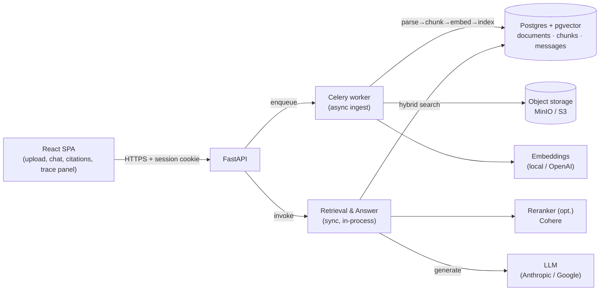

# Chat With Your Docs

A RAG assistant for asking questions over your own uploaded documents (PDF/txt/Markdown).

Backend: FastAPI + Celery (Python). Frontend: Vite + React + TypeScript + Tailwind. Data: Postgres
+ pgvector, Redis, S3-compatible object storage (MinIO locally, real S3 in the AWS reference
architecture under `infra/`).

## Quick setup

```
docker compose up
```

Starts everything: `api` (http://localhost:8000, docs at `/docs`), `worker` (Celery ingestion),
`postgres` (pgvector, port `5433`), `redis`, `minio` (port `9001`), `frontend`
(http://localhost:5173).

Runs fully key-free out of the box — upload, ingestion, and status tracking all work with zero
setup. Only answering needs a key:

```
cp backend/.env.example backend/.env
# set ANTHROPIC_API_KEY in backend/.env
```

No key → chat fails with a clear "missing credentials" error, everything else still works.

## Architecture overview



Two request-time paths:

- **Ingest (async)**: upload → Celery worker → parse → chunk → embed → index. Background, so a
  large PDF never blocks the HTTP request.
- **Ask (sync)**: question → hybrid retrieval → optional rerank → generate → cited answer. One
  in-process call, no task queue — it's bounded, not a background job.

Every external dependency (LLM, embeddings, reranker, object storage, secrets) sits behind an
adapter interface, swapped by one config value. Details: [Key technical
decisions](#key-technical-decisions).

Full ticket-by-ticket system diagram: [`docs/architecture.md`](docs/architecture.md). AWS
deployment topology diagram (VPC, ALB, ECS, RDS, ElastiCache, CloudFront): [same
file](docs/architecture.md#aws-deployment-topology-infra-issue-23).

## Productionizing on a hyperscaler (AWS)

Runs locally only for this submission (`docker compose up`) — no live deployment, by design.

| Piece | Status |
|---|---|
| Infrastructure as code | ✅ Done — `infra/` (AWS CDK, Python): VPC, ECS Fargate (api+worker), RDS Postgres+pgvector, ElastiCache, S3×2, CloudFront, Secrets Manager, least-privilege IAM role. `cdk deploy` works; never run against a real account. See [`infra/README.md`](infra/README.md). |
| Health checks | ✅ Done — ALB target group checks `GET /health`. |
| Secrets management | ✅ Mostly done — `SecretManager` (local file / AWS Secrets Manager) wired into every provider key, `.env` fallback. Missing: real account, real values, rotation. |
| Auth | ❌ Not built — anonymous session cookie only. [Issue #25](https://github.com/NP-Assignments-Labs/fde-amiay-narayan-41f10caa/issues/25). |
| Rate limiting | ❌ Not built. [Issue #26](https://github.com/NP-Assignments-Labs/fde-amiay-narayan-41f10caa/issues/26). |
| Live cutover | ❌ Not built — deploy, DNS, rollback plan. [Issue #28](https://github.com/NP-Assignments-Labs/fde-amiay-narayan-41f10caa/issues/28). |
| HA / hardening | ❌ Single-AZ RDS, single-node Redis, `RemovalPolicy.DESTROY`, no ACM cert, no autoscaling. Full list: [`infra/README.md`](infra/README.md). |

**Why AWS, not GCP/Azure/Cloudflare**: My familiarity with the tech stack: ECS Fargate + RDS
+ ElastiCache + S3 maps directly onto this app's actual shape — two stateless compute services, 
one relational store with a vector extension, one cache/broker, one blob store.

## RAG and LLM approach and decisions

- **LLM** — An swappable set of implementation of the popular LLMs out there: Haiku, Gemini they are 
  cheap and perfect for development and POC stage.
  Details: [`docs/llm-providers.md`](docs/llm-providers.md).
- **Embedding model** — local `sentence-transformers` (`BAAI/bge-small-en-v1.5`, 384-dim),
  default. *Why*: zero cost, zero key, runs on-machine, ~parity with OpenAI's
  `text-embedding-3-small` on MTEB despite being ~1000x smaller. Second implementation: OpenAI,
  hosted. Switching is a schema change, not a config flip — the pgvector column is fixed-width.
  Details: [`docs/embeddings.md`](docs/embeddings.md).
- **Vector database** — Postgres + `pgvector`, not a dedicated vector DB. *Why*: one datastore
  instead of two. Hybrid search (vector + full-text) becomes one SQL query, not a fan-out that
  needs reconciling.
- **Orchestration framework** — none as of now (e.g. LangChain). *Why*: the whole pipeline
  (`answer_question` in `backend/app/qa/answering.py`) is ~130 lines of plain Python — embed,
  retrieve, optionally rerank, prompt, generate, cite. No agent loop, no dynamic tool selection.
  A framework adds a dependency and an abstraction layer without buying anything back here.
- **Prompt and context management** — retrieved chunks go into one `<context>` block, explicitly
  marked as data, not instructions (prompt-injection resistance against a malicious document).
  History is passed as prior turns, capped at the last 10 messages. Citations are built from
  exactly the chunks placed in `<context>` — never the wider candidate pool — so every citation
  is traceable to something the model actually saw.
- **Guardrails** — two layers, so a bad answer has to get past both. The first is deterministic:
  if nothing retrieved clears the relevance threshold and nothing matches on keyword search, the
  app refuses outright, before the LLM is ever called — no room for a plausible-sounding
  hallucination to slip through on clever phrasing. The second lives in the prompt itself: the
  system prompt tells the model to say plainly when it doesn't have enough information instead of
  guessing. This was checked live, not just with a unit test — a single-document corpus was asked
  a question it had no answer for, and it correctly said so instead of making something up.
- **Quality** — `backend/app/eval/`: a golden Q&A set scored for retrieval hit-rate and
  LLM-as-judge faithfulness, run through both vector-only and vector+rerank so the reranker's
  contribution is a measured delta, not an assumption. Runs in CI when judge/reranker keys are set.
- **Observability** — every answer carries a trace object: retrieval hits, rerank scores, the
  exact assembled prompt, token counts, per-stage latency. Rendered in an in-app inspector panel.
  Structured JSON logs per pipeline stage server-side, independent of the UI.

## Key technical decisions

_To fill in — one bullet per decision: what was chosen, why. Candidates already touched on above,
pick whichever actually mattered most and say why in your own words:_

- Adapter interfaces + dependency injection for every external dependency
- Hybrid retrieval (vector + keyword), not vector-only
- Structure-aware chunking with an overlap fallback
- Async ingestion, sync answering
- Session-cookie identity, no accounts
- Embedding model/version recorded per chunk (the "indexing contract")
- One shared retry/timeout policy across every provider adapter
- `SecretManager` resolves with an `.env` fallback, not a hard replacement

## Engineering standards followed (and skipped)

**Followed**

- TDD throughout — tests before implementation, red → green, every module
- Tests at the HTTP API boundary against a real Postgres; only external-network calls faked, no
  mocking of internals
- 100% test coverage, backend and frontend, enforced in CI
- Adapter + DI pattern applied consistently, not just for the first dependency
- Structured logging + in-app trace panel for observability
- CI on every push: lint, type-check, tests, eval harness
- Document content structurally separated from instructions in the prompt (prompt-injection
  resistance)
- Retrieval filtering (session/document scope) applied inside the query, never as a post-filter

**Skipped, on purpose**

- No live deployment
- No auth beyond an anonymous session cookie
- No API rate limiting
- No token-by-token streaming
- No vector DB beyond pgvector (a choice, not a gap — see above)
- Local embedding model reloads on every call instead of being cached per-process — a real,
  measured ~40s cost, left unfixed until its interaction with Celery's forking workers gets a
  proper look

## How I used AI tools in development

<!-- Draft from this session's actual process. Rewrite in your own words before submitting —
the brief asks for your thoughts, not an LLM's. -->

- **Brief → spec**: ran the `grill-with-docs` skill against the client brief — an interview-style
  skill that grills a plan until it's sharp, writing docs as it goes. Turned a short brief into a
  full spec (problem statement, user stories, implementation/testing decisions, explicit
  out-of-scope), published to the tracker as [issue #1](https://github.com/NP-Assignments-Labs/fde-amiay-narayan-41f10caa/issues/1).
- **Spec → tickets**: ran `to-tickets` to decompose that spec into vertical-slice tickets, each
  with acceptance criteria and blocking edges. Every technology choice and trade-off in those
  tickets — pgvector vs. a dedicated vector DB, the adapter pattern, hybrid retrieval, async
  ingestion, session-cookie identity, and so on — was brainstormed and decided by me, from prior
  engineering experience. AI wrote the ticket text; I made the calls it's writing up.
- **Tickets → code**: automated the implementation and testing loop from there — each ticket run
  test-first (red → green), lint/type-check/full suite, then a two-axis review (repo standards +
  code smells; separately, spec compliance) before commit.
- **Checked output rather than trusting it**: ran `cdk synth` against the generated infrastructure
  code and fixed the real warnings it produced (unencrypted RDS, missing circuit breakers) before
  writing tests against it. Found a worker container that had been crash-looping for days on a
  missing dependency by actually starting the stack, not just running the test suite. Verified the
  full upload → ingest → ask → cited-answer flow against a live LLM call.

## What I'd do differently with more time

<!-- Same caveat — starting list of real gaps, not a substitute for your own priorities. -->

- Fix the embedding model's per-call reload with a process-level cache
- Add token-by-token response streaming
- Grow the eval harness's golden set; tune chunk size/overlap and the relevance threshold against
  measured data instead of stated hypotheses
- Build real auth and rate limiting
- More UI/UX polish on the frontend — built to demonstrate every backend capability, not for
  visual design

## Screenshots

_To add: upload flow, chat with citations, the trace panel, document management._
