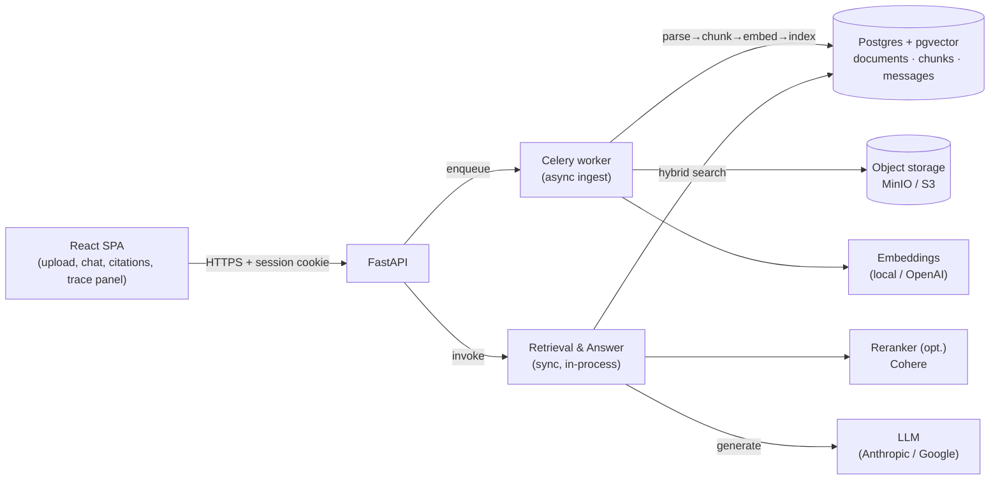

# Chat With Your Docs

A RAG assistant for asking questions over your own uploaded documents (PDF/txt/Markdown).

Backend: FastAPI + Celery (Python). Frontend: Vite + React + TypeScript + Tailwind. Data: Postgres
+ pgvector, Redis, S3-compatible object storage (MinIO locally, real S3 in the AWS reference
architecture under `infra/`).

## Quick setup

```
docker compose up
```

This starts everything: `api` (FastAPI, http://localhost:8000 — interactive docs at `/docs` and
`/redoc`), `worker` (Celery, background ingestion), `postgres` (with `pgvector`, host port
`5433`), `redis`, `minio` (S3-compatible storage, console on http://localhost:9001), and
`frontend` (Vite dev server, http://localhost:5173).

It runs **fully key-free out of the box** — upload, ingestion, and status tracking all work with
no setup. Only the answer step needs a real LLM key; without one it fails with a clear "missing
credentials" error rather than hanging or crashing. Copy `backend/.env.example` to `backend/.env`
and set `ANTHROPIC_API_KEY` to get real answers (see [RAG and LLM approach](#rag-and-llm-approach-and-decisions)
below for why Anthropic/local-embeddings are the defaults, and what the alternatives are).

Provider credentials are resolved through a `SecretManager` adapter first (`local`, reading a
gitignored `backend/.secrets` file, or `aws` for AWS Secrets Manager), falling back to the
`.env`/environment values above when a key isn't set there — see [`docs/secrets.md`](docs/secrets.md).

### Backend development (without Docker)

Requires `postgres`, `redis`, and `minio` running (`docker compose up -d postgres redis minio`).

```
cd backend
uv sync --group dev
uv run alembic upgrade head
uv run pytest -q                                    # fast suite (fakes only, no live services)
uv run uvicorn app.main:app --reload
```

The fast suite alone won't show 100% coverage — the real provider adapters' network-client code
paths (e.g. `S3ObjectStorage` actually talking to MinIO) are only exercised by the
`integration`-marked tests, which need `postgres`/`minio` running. Together they're 100%,
enforced via `fail_under = 100` in `pyproject.toml`:

```
uv run pytest -m "integration or not integration" --cov=app --cov-report=term-missing
```

### Frontend development (without Docker)

Requires Node ≥ 22 (see `frontend/.nvmrc`).

```
cd frontend
npm install --legacy-peer-deps
npm run dev
npm run test:coverage  # 100% statements/branches/functions/lines, enforced via vite.config.ts
```

### Evaluation harness

Measures retrieval hit-rate and LLM-as-judge faithfulness/relevancy against a small golden Q&A
set, run through both the vector-only and vector+rerank pipeline modes so the reranker's
contribution is a measured number, not an assumption (`backend/app/eval/`).

```
cd backend
uv run python -m app.eval
```

Also runs as its own CI job on every push, publishing the report to the job summary — but only
when `GOOGLE_API_KEY`/`COHERE_API_KEY` are configured as repo secrets (skipped, not failed,
otherwise; that's the current state of this repo).

## Architecture overview



Two request-time lanes hang off the API: an **async ingest path** (upload → Celery worker →
parse/chunk/embed/index into Postgres+pgvector, so a large PDF never blocks the HTTP request) and
a **sync ask path** (question → hybrid retrieval → optional rerank → LLM generation → cited
answer, all in the API process — no separate task-queue round trip, since it's one bounded call,
not a background job). Every external dependency (LLM, embeddings, reranker, object storage) sits
behind a small adapter interface with a swappable implementation, selected by one config value —
see [Key technical decisions](#key-technical-decisions) below.

The full, ticket-by-ticket system diagram (every component, what's built vs. planned, with a GitHub
issue per box) lives in [`docs/architecture.md`](docs/architecture.md); the AWS deployment topology
diagram (VPC, subnets, ALB, ECS, RDS, ElastiCache, CloudFront — what `infra/`'s CDK app actually
provisions) is in the same file, [here](docs/architecture.md#aws-deployment-topology-infra-issue-23).

## Productionizing on a hyperscaler (AWS)

This submission runs locally only (`docker compose up`) by design — see issue #1's Out of Scope.
Getting to a real AWS deployment breaks down into:

1. **Infrastructure as code** — ✅ done. `infra/` is a working AWS CDK (Python) app: VPC, ECS
   Fargate for `api`+`worker`, RDS Postgres 16 with `pgvector`, ElastiCache Redis, two S3 buckets
   (uploaded documents + frontend static hosting behind CloudFront), Secrets Manager, and a
   least-privilege IAM task role. `cdk deploy` would stand this up against a real account; nobody
   has run it against one. See [`infra/README.md`](infra/README.md) for deploy steps and the
   topology diagram linked above.
2. **Health checks** — ✅ done, as part of the same CDK stack: the ALB target group's health check
   targets the app's existing `GET /health`.
3. **Secrets management** — ✅ mostly done: `SecretManager` (`local` file / AWS Secrets Manager,
   `docs/secrets.md`) is wired into every provider credential with an `.env` fallback, and the CDK
   stack provisions the four secrets + a scoped IAM role. What's left is a real account, real key
   values (never committed), and a rotation policy.
4. **Not yet built** — tracked as real, linked GitHub issues rather than left as prose:
   [auth](https://github.com/NP-Assignments-Labs/fde-amiay-narayan-41f10caa/issues/25) (real
   accounts + multi-tenant isolation, replacing the current anonymous-session-cookie model),
   [rate limiting](https://github.com/NP-Assignments-Labs/fde-amiay-narayan-41f10caa/issues/26)
   (per-session/IP throttling — both abuse protection and provider-cost control), and
   [live cutover](https://github.com/NP-Assignments-Labs/fde-amiay-narayan-41f10caa/issues/28)
   itself (actually deploying, DNS, a rollback plan).
5. **Hardening not yet applied to the reference stack** (see `infra/README.md`'s full list):
   single-AZ RDS/single-node Redis (no HA), 1-day backup retention, `RemovalPolicy.DESTROY`
   everywhere (so `cdk destroy` leaves nothing behind — deliberate for a stack nobody runs
   long-term), no ACM certificate/custom domain on the ALB, no autoscaling, no CI/CD pipeline
   actually running `cdk deploy`.

Why AWS specifically, not GCP/Azure/Cloudflare: ECS Fargate + RDS + ElastiCache + S3 is the
combination I'm most familiar operating, and it maps cleanly onto this app's actual shape (two
stateless compute services, one relational store with a vector extension, one cache/broker, one
blob store) without needing a bigger platform (EKS/GKE, a managed vector DB service) this app's
scale doesn't call for.

## RAG and LLM approach and decisions

- **LLM**: Anthropic Claude (`claude-haiku-4-5`) by default, via a small `LLMProvider` interface
  with a second real implementation for Google Gemini (`LLM_PROVIDER=google` — a genuine
  rate-limited free tier, useful for running this without a paid key). Haiku, not a larger model:
  answering here is one stateless call per question — no tool use, no multi-turn agent loop — so a
  bigger/pricier model buys nothing. See [`docs/llm-providers.md`](docs/llm-providers.md).
- **Embedding model**: a local `sentence-transformers` model (`BAAI/bge-small-en-v1.5`, 384-dim) is
  the *default* — zero API key/cost, runs on-machine, and benchmarks roughly at parity with OpenAI's
  `text-embedding-3-small` on standard retrieval benchmarks (MTEB) despite being ~1000x smaller. A
  second `EmbeddingProvider` implementation (OpenAI, hosted) exists behind the same interface. See
  [`docs/embeddings.md`](docs/embeddings.md) for why switching is a real schema change (the
  `chunks.embedding` pgvector column is fixed-width), not just a config flip.
- **Vector database**: Postgres + the `pgvector` extension, not a dedicated vector DB (Pinecone/
  Weaviate/Qdrant/etc). One less moving part to run/deploy for a corpus this size, and it means
  hybrid search (vector similarity *and* Postgres full-text search) is one SQL query against one
  datastore rather than a fan-out across two systems that then need reconciling.
- **Orchestration framework**: none — no LangChain/LlamaIndex. The whole pipeline
  (`backend/app/qa/answering.py`'s `answer_question`) is ~130 lines of plain Python: embed the
  query → hybrid retrieve → optionally rerank → assemble the prompt → call the LLM → build
  citations/trace. That's a deliberate choice, not an oversight: the actual control flow here is
  simple enough (no agent loop, no dynamic tool selection) that a framework would add an
  abstraction layer and a dependency without buying anything back — every step is directly
  readable and independently testable as-is.
- **Prompt & context management**: retrieved chunks go into one `<context>` block in the system
  prompt, explicitly marked as inert data the model should treat as reference material, not
  instructions — direct prompt-injection resistance against a malicious document (`_SYSTEM_TEMPLATE`
  in `answering.py`). Conversation history (bounded to the last `chat_history_max_messages`,
  default 10) is passed as prior turns, not re-stated in the prompt text, so a follow-up question
  can reference earlier context. Citations are built from *exactly* the chunks that made it into
  that `<context>` block — not the full retrieval candidate pool — so a citation is always
  traceable to something the model actually saw.
- **Guardrails**: two layers. A deterministic one — no chunk clears the relevance threshold
  (`retrieval_relevance_threshold`, cosine distance) or matches the keyword search branch → the app
  refuses without ever calling the LLM (`_NO_EVIDENCE_MESSAGE`), so an empty/off-topic corpus can't
  be talked into a hallucinated answer by clever phrasing. A second, model-level one — the system
  prompt itself instructs the model to say plainly when the context doesn't answer the question
  rather than guess; verified live (a single-document corpus, asked an unrelated question, answered
  "I don't have enough information" instead of confabulating — see the guardrail tests,
  `backend/tests/test_guardrails.py`).
- **Quality**: `backend/app/eval/` — a golden Q&A set scored for retrieval hit-rate and LLM-as-judge
  faithfulness/relevancy, run through *both* the vector-only and vector+rerank pipelines so the
  reranker's actual contribution is a measured delta, not an assumed one. Runs in CI (`eval` job)
  when the (free-tier) judge/reranker keys are configured.
- **Observability**: every answer carries a `trace` object — retrieval hits (with distance,
  keyword-match, and whether each one actually made the final prompt), rerank scores, the exact
  assembled prompt, token counts, and per-stage latency — rendered in an in-app "inspect this
  answer" panel, plus structured JSON logs per pipeline stage server-side (`_log_stage` in
  `answering.py`) for debugging without the UI.

## Key technical decisions

- **Adapter interfaces + dependency injection for every external dependency** (`LLMProvider`,
  `EmbeddingProvider`, `RerankerProvider`, `ObjectStorage`, `SecretManager` — all in
  `backend/app/adapters/`, selected by `app/providers.py`'s `get_*()` factories and one config
  toggle each). This is the single most load-bearing decision in the codebase: it's why tests fake
  exactly four (now five) real network boundaries instead of mocking internals, why adding Gemini
  alongside Anthropic or AWS Secrets Manager alongside a local file was additive rather than a
  rewrite, and why the whole app can run fully offline/key-free by default.
- **Hybrid retrieval (vector + keyword), not vector-only** — a chunk counts as relevant if it
  clears the cosine-distance threshold *or* matches Postgres full-text search outright, so an
  exact-term query (a name, a code, a date) isn't at the mercy of embedding-space fuzziness alone.
- **Structure-aware chunking with an overlap fallback**, not naive fixed-size splitting — respects
  page/paragraph/heading boundaries where the source format has them, falling back to an overlap
  split (~10%, a stated starting hypothesis, not a locked constant) where it doesn't.
- **Async ingestion (Celery), sync answering** — ingestion is a background job because a large PDF
  parsing/chunking/embedding shouldn't hold an HTTP connection open; answering is one bounded
  in-process call because it isn't a long-running job and a task-queue round trip would only add
  latency for no benefit.
- **Session-cookie identity, no accounts** — deliberately out of scope for this submission (see
  issue #1); every document/conversation is scoped to an anonymous, secure session cookie. Real
  auth is tracked as [issue #25](https://github.com/NP-Assignments-Labs/fde-amiay-narayan-41f10caa/issues/25),
  not silently skipped.
- **The embedding model/version is recorded on every stored chunk** (the "indexing contract") so a
  future embedding-model change is *detectable* rather than silently mixing incompatible vectors
  in the same index — re-indexing becomes a deliberate, scoped decision instead of a subtle bug.
- **Bounded retry/timeout, uniformly, not per-adapter** — one shared policy
  (`app/adapters/retry.py`) used by all four provider adapters: exponential backoff on transient
  failures (timeouts, 429, 5xx), immediate failure on invalid-request/auth errors, since retrying
  those can't help.
- **`SecretManager` resolves credentials with an `.env` fallback, not a hard replacement** — new
  code (and the CDK stack) can source secrets from AWS Secrets Manager or a local file, while every
  existing provider key keeps working unchanged if that source has nothing configured for it. A
  smaller, safer migration than forcing every credential through a new system in one move.

## Engineering standards followed (and skipped)

**Followed**: TDD throughout (tests before implementation, red→green, on every module including
this session's later additions — the secret manager adapter, the CDK infra, the DB-URL and
S3-credential fixes it needed); tests at the highest reasonable seam (the HTTP API boundary,
via `TestClient` against a real Postgres, with only the four external-network boundaries faked —
no mocking of internal collaborators); 100% test coverage on both backend (`fail_under = 100`,
fast + integration combined) and frontend, enforced in CI, not just claimed; the adapter +
dependency-injection pattern applied consistently to every external dependency, not just the
first one; structured logging + an in-app trace panel for observability; a CI pipeline (lint,
type-check, tests, eval harness) on every push; retrieved document content structurally separated
from instructions in the prompt, specifically to resist prompt injection from a malicious upload;
document-scoped and session-scoped retrieval filtering applied *inside* the query itself, never
as a post-filter on already-fetched results.

**Skipped, deliberately, and documented rather than hidden**: no live/hosted deployment (see
"Productionizing" above); no authentication beyond an anonymous session cookie; no API rate
limiting; no token-by-token response streaming; no vector database beyond pgvector (see "Vector
database" above for why that's a choice, not a gap); the local embedding provider reloads its
model on every call rather than caching it per-process (a real, measured ~40s cost per
call — deliberately left unfixed; the tradeoff is documented in `docs/embeddings.md` and needs a
deliberate look at Celery's forking worker model before it's safe to fix, not a quick patch).

## How I used AI tools in development

<!-- Drafted from this session's actual process; the assignment brief asks for your own words
here specifically ("we need your thoughts, not an LLM's direct output") — treat this as raw
material to rewrite in your own voice, not a final answer, before submitting. -->

I built this with Claude Code end-to-end, working spec-first rather than prompt-first: every
feature started as a GitHub issue with acceptance criteria (`docs/agents/issue-tracker.md`'s
convention), not an ad-hoc chat request, so there was always a concrete, checkable definition of
"done" before any code got written. Each ticket went through the same loop: implement test-first
(red before green), run the full type-check/lint/test suite, then a separate two-axis code review
pass (one pass checking the diff against documented repo standards + a Fowler code-smell
checklist, a second pass checking it against the originating spec) before committing — so review
wasn't "does this look plausible" but "does this match what was actually asked for, and does it
follow this codebase's own conventions."

I didn't take AI output on faith where it was checkable: the CDK infrastructure work is the
clearest example — rather than writing CDK and assuming it was right, I actually ran `cdk synth`
against it, read the real warnings CDK's own validator produced (an unencrypted RDS instance,
missing circuit breakers, a deprecated API), fixed them, and only then wrote the assertion tests
against the real synthesized CloudFormation output. The same pattern held for the backend: I stood
up the actual Docker containers, found a worker container that had been silently crash-looping for
days on a missing dependency, and verified the full upload→ingest→ask→cited-answer flow against a
live LLM call rather than trusting that fakes-only test coverage meant the real thing worked. A
few early tests I wrote turned out to have wrong assertions, not the code under test — normal TDD
noise, but worth naming rather than pretending every AI-written test was correct on the first try.

## What I'd do differently with more time

<!-- Same caveat as above — these are real, specific gaps surfaced while building this, offered
as a starting list, not a substitute for your own priorities. -->

- Fix the local embedding provider's per-call model reload (documented, deliberately deferred —
  see `docs/embeddings.md`) with a process-level cache, once its interaction with Celery's forking
  worker model has had a real look rather than a quick patch.
- Add token-by-token response streaming — the full-response-at-once UX is the most noticeable gap
  against a "real" chat product, and was explicitly named as a future enhancement rather than
  attempted here.
- Grow the evaluation harness's golden set beyond a small starting set per demo document, and use
  it to actually tune chunk size/overlap and the retrieval relevance threshold against measured
  data instead of the stated starting hypotheses they currently are.
- Build real authentication and rate limiting (issues #25/#26) — the two most consequential gaps
  standing between this and something safe to put in front of the public internet.
- Spend more UI/UX time on the frontend specifically — it was built to be functional and to
  demonstrate every backend capability (citations, trace panel, document scoping, retry), not
  polished for visual design, which was a deliberate time trade-off given the assignment's own
  framing ("a solid, well-engineered basic solution beats an over-engineered complex one").

## Screenshots

_TODO: add screenshots (or a short video) of the running app here before submitting — upload flow,
chat with citations, the trace panel, and document management are the most representative views._
