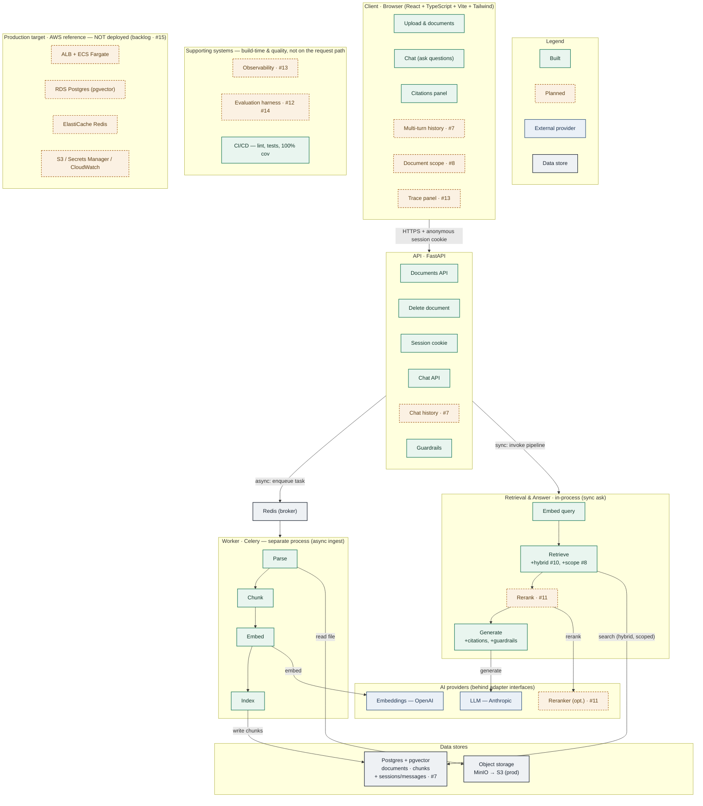

# System Architecture

Full planned architecture of **Chat With Your Docs**, as frozen in issue #1 and decomposed
across tickets 1–16. This reflects the whole plan, not just what's built so far — see the
[status legend](#status-legend) and [ticket ledger](#ticket-ledger) below for what's actually
shipped.

An interactive version of this same diagram (with hover-friendly layout) is also available as a
published artifact from this session, if you have that link.

## Status legend

| Style | Meaning |
| --- | --- |
| 🟢 solid green | **Built** — tickets 1–6, closed |
| 🟠 dashed amber | **Planned** — tickets 7–16, `ready-for-agent`, not yet built |
| 🔵 blue | External AI provider (Anthropic, OpenAI) |
| ⬜ grey | Data store / infrastructure |

## Diagram

Two request-time lanes hang off the API: an **asynchronous ingest path** (API → Redis → Celery
worker → object storage / pgvector / embeddings) and a **synchronous ask path** (API → retrieval
& answer, in the same process → pgvector / LLM / reranker). Supporting systems (observability,
evaluation, CI/CD) surround the request path but don't sit on it. The AWS panel is the documented
production target — dashed throughout, because none of it is deployed.

## Ticket ledger

| # | GH issue | Ticket | Status | Diagram area |
| - | - | - | - | - |
| 1 | #2 | Project scaffolding (prefactoring) | 🟢 Built | Repo, Docker Compose, CI |
| 2 | #3 | Upload → background ingest → status tracking | 🟢 Built | Client, API, Worker, Data stores |
| 3 | #4 | Single-turn Q&A over ingested documents | 🟢 Built | Client, API, Retrieval & Answer, LLM |
| 4 | #5 | Citations & source panel | 🟢 Built | Client, Retrieval & Answer |
| 5 | #6 | Answer-time guardrails | 🟢 Built | API, Retrieval & Answer |
| 6 | #7 | Document deletion | 🟢 Built | API, Data stores |
| 7 | #8 | Multi-turn conversation + session persistence + empty states | 🟠 Planned | Client, API, Data stores |
| 8 | #9 | Document-scoped retrieval filtering | 🟠 Planned | Client, Retrieval & Answer |
| 9 | #10 | Structure-aware chunking upgrade | 🟠 Planned | Worker |
| 10 | #11 | Hybrid retrieval (vector + keyword) | 🟠 Planned | Retrieval & Answer, Data stores |
| 11 | #12 | Optional reranker toggle | 🟠 Planned | Retrieval & Answer, AI providers |
| 12 | #13 | Evaluation harness | 🟠 Planned | Evaluation & Quality |
| 13 | #14 | In-app trace panel + structured logging | 🟠 Planned | Client, Observability |
| 14 | #15 | CI: add eval harness job | 🟠 Planned | CI/CD, Evaluation & Quality |
| 15 | #16 | Deployment follow-up backlog | 🟠 Planned | Production target (AWS) |
| 16 | #17 | Final README + submission polish | 🟠 Planned | — |

16 tickets · 6 built · 10 planned. Zero open `needs-triage`/`needs-info` items — every ticket
above is `ready-for-agent` in the tracker.
