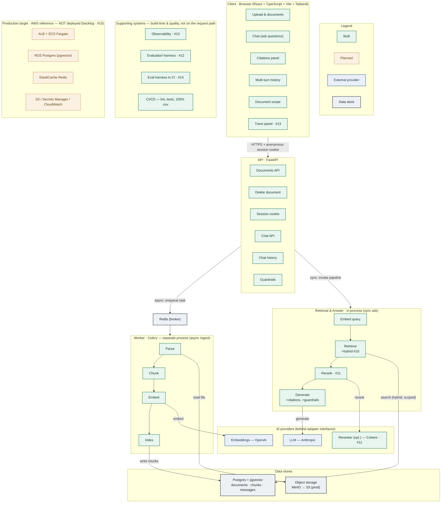
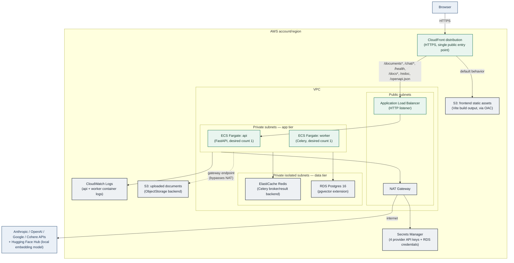

# System Architecture

**Chat With Your Docs** is a RAG assistant: upload PDFs, text, or Markdown files, ask questions
about them, and get answers grounded in your own documents with citations back to the source
passage. This document walks through the diagram below — what each piece is and why it's there —
then does the same for the AWS deployment target.

## System diagram

Green = built. Amber dashed = planned, not built. Blue = an external AI vendor. Grey = a data
store.

### What each box is, and why it's there

- **Client** — the React SPA. The only thing a user touches: upload, chat, citations, document
  scoping, and a trace panel for inspecting how an answer was produced. Talks to the API only over
  HTTPS with a session cookie — no separate client-side state that could drift from the server.
- **API (FastAPI)** — the single entry point for both uploads and questions. Owns the session
  cookie (this app's only identity model — no accounts) and the guardrails that decide whether a
  question gets an LLM call or a deterministic refusal. Everything the client can do goes through
  here; there's no second door into the system.
- **Redis** — the queue between the API and the worker. Exists for one reason: so a large PDF
  upload doesn't hold the HTTP connection open. The API enqueues a task and returns immediately.
- **Worker (Celery)** — a separate process that does the actual ingestion work: parse → chunk →
  embed → index. Runs out-of-request so ingestion time (seconds to tens of seconds) never blocks
  the upload response.
- **Retrieval & Answer** — the pipeline behind every question: embed the query, retrieve
  (hybrid vector + keyword), optionally rerank, generate an answer, attach citations. Runs
  in-process, not through Redis/the worker, because it's one bounded call — a task queue would
  only add latency here, not remove blocking.
- **Data stores** — Postgres with the `pgvector` extension holds documents, chunks, embeddings,
  and messages in one database (not a separate vector DB); object storage (MinIO locally, S3 in
  production) holds the raw uploaded files. One relational store instead of two systems that would
  otherwise need to stay in sync.
- **AI providers** — LLM, embeddings, and an optional reranker, each behind a small adapter
  interface. The concrete vendor (Anthropic vs. Google, local vs. OpenAI, Cohere) is a config
  choice, not a code change — this is why the app can run fully offline/key-free by default.
- **Supporting systems** — structured logging, the in-app trace panel, and the evaluation harness
  (retrieval hit-rate + LLM-as-judge faithfulness) sit alongside the request path, not on it — none
  of them run on the way to answering a question. CI runs lint, tests, and the eval harness on
  every push.
- **Production target (AWS)** — dashed, because it isn't deployed. The next section is what
  actually provisions it.

### The two request-time paths

- **Ingest (async)**: upload → API enqueues on Redis → worker parses/chunks/embeds/indexes.
  Asynchronous so a slow upload never times out the request.
- **Ask (sync)**: question → API invokes retrieval & answer in-process → hybrid search → optional
  rerank → LLM call → cited answer. Synchronous because it's one bounded round trip, not a
  background job.

## AWS deployment topology

`infra/` is a working AWS CDK (Python) app that provisions the diagram below for real —
`cdk deploy` stands it up, `cdk destroy` tears it down. It has never been pointed at a live
account: this app runs locally only for this submission (see the README's "Production deployment
(deferred)" section). What follows is what that code builds, not a description of something
currently running.

11 edges instead of 20 — `api` and `worker` share every downstream dependency except ALB traffic
(worker has none), so those shared edges are drawn once, from the app-tier subnet boundary, rather
than duplicated per service. The IAM role is noted on the subnet it applies to instead of drawn as
a separate box with its own arrows — a permission grant isn't a data flow, and drawing it as one
was most of what made this diagram noisy.

### What each box is, and why it's there

- **CloudFront** — the one public entry point for the whole app, frontend and API both. Keeps the
  browser on a single origin, so the frontend never needs to know the API's real address at build
  time.
- **Application Load Balancer** — routes CloudFront's API-path traffic to the `api` ECS service,
  and runs the health check ECS uses to decide whether a task is alive and should keep receiving
  traffic.
- **NAT Gateway** — the only way out of the private app subnets to the public internet. Used for
  calls to the LLM/embedding/rerank provider APIs and Hugging Face Hub. S3 traffic deliberately
  bypasses it (see the gateway endpoint below) since that's the one dependency this app talks to
  heavily enough for NAT's per-byte cost to matter.
- **ECS Fargate — api** — the FastAPI process, containerized, no server to patch or manage.
- **ECS Fargate — worker** — the Celery process. No load balancer: it has no HTTP interface, it
  only pulls tasks from Redis. Both services share one IAM role, scoped to exactly what they need
  — those four named secrets (not a broad `secretsmanager:*`), the RDS secret, and the documents
  bucket, nothing wider — which is why it's noted on the subnet rather than drawn as its own box
  with its own arrows.
- **RDS Postgres (pgvector)** — the same database engine as local dev, just managed. Sits in a
  private isolated subnet with no route to the internet at all, in or out — the app tier reaches
  it directly over the VPC.
- **ElastiCache Redis** — managed Redis playing the same broker/result-backend role local Redis
  plays in `docker compose`.
- **S3 — frontend static assets** — hosts the built frontend (`frontend/dist`), served through
  CloudFront rather than run as a container — a static SPA build has no reason to need a running
  process.
- **S3 — uploaded documents** — the production `ObjectStorage` backend, the same role MinIO plays
  locally. Reached via a free VPC gateway endpoint instead of the NAT gateway.
- **Secrets Manager** — holds the four provider API keys and the RDS-generated credentials, read
  by this app's own `SecretManager` adapter (`AWSSecretManager`, see `docs/secrets.md`) rather
  than baked into the task definition. Reached over the NAT gateway (no VPC interface endpoint for
  Secrets Manager here — one more thing a hardening pass would add).
- **CloudWatch Logs** — where both ECS services' container logs land, so a crashed task's cause is
  visible without shelling in.

### What's reference-shaped here, not production-hardened

A single NAT gateway (not one per AZ), single-AZ RDS, a single-node ElastiCache cluster (no
Multi-AZ/replication), `RemovalPolicy.DESTROY` on both S3 buckets and the database (so
`cdk destroy` leaves nothing behind — this stack is never actually deployed), and a plain-HTTP ALB
listener with no ACM certificate or custom domain (CloudFront-to-viewer is still HTTPS; only the
CloudFront-to-ALB hop inside AWS is not). None of these are hard to change — they're what a
reference stack that's never actually deployed needs, not a ceiling. Full list and reasoning:
[`infra/README.md`](../infra/README.md).
