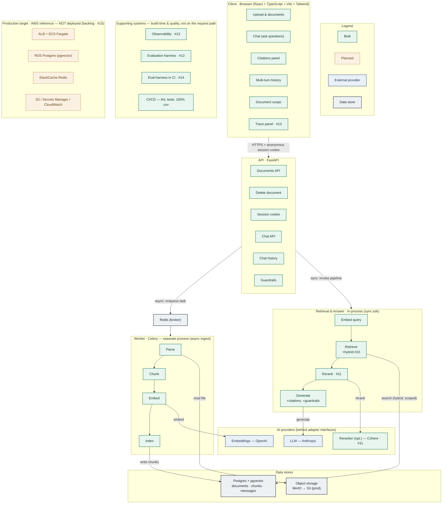
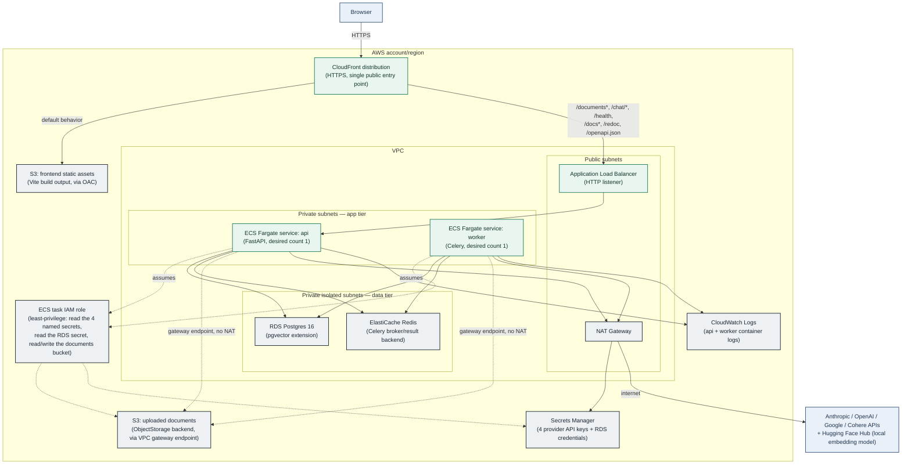

# System Architecture

Full planned architecture of **Chat With Your Docs**, as frozen in issue #1 and decomposed
across tickets 1–16. This reflects the whole plan, not just what's built so far — see the
[status legend](#status-legend) and [ticket ledger](#ticket-ledger) below for what's actually
shipped.

An interactive version of this same diagram (with hover-friendly layout) is also available as a
published artifact from this session, if you have that link.

## Status legend

| Style | Meaning |
| --- | --- |
| 🟢 solid green | **Built** — tickets 1–14, closed |
| 🟠 dashed amber | **Planned** — tickets 15, 16, `ready-for-agent`, not yet built |
| 🔵 blue | External AI provider (Anthropic, OpenAI) |
| ⬜ grey | Data store / infrastructure |

## Diagram

Two request-time lanes hang off the API: an **asynchronous ingest path** (API → Redis → Celery
worker → object storage / pgvector / embeddings) and a **synchronous ask path** (API → retrieval
& answer, in the same process → pgvector / LLM / reranker). Supporting systems (observability,
evaluation, CI/CD) surround the request path but don't sit on it. The AWS panel is the documented
production target — dashed throughout, because none of it is deployed.

## Ticket ledger

| # | GH issue | Ticket | Status | Diagram area |
| - | - | - | - | - |
| 1 | #2 | Project scaffolding (prefactoring) | 🟢 Built | Repo, Docker Compose, CI |
| 2 | #3 | Upload → background ingest → status tracking | 🟢 Built | Client, API, Worker, Data stores |
| 3 | #4 | Single-turn Q&A over ingested documents | 🟢 Built | Client, API, Retrieval & Answer, LLM |
| 4 | #5 | Citations & source panel | 🟢 Built | Client, Retrieval & Answer |
| 5 | #6 | Answer-time guardrails | 🟢 Built | API, Retrieval & Answer |
| 6 | #7 | Document deletion | 🟢 Built | API, Data stores |
| 7 | #8 | Multi-turn conversation + session persistence + empty states | 🟢 Built | Client, API, Data stores |
| 8 | #9 | Document-scoped retrieval filtering | 🟢 Built | Client, Retrieval & Answer |
| 9 | #10 | Structure-aware chunking upgrade | 🟢 Built | Worker |
| 10 | #11 | Hybrid retrieval (vector + keyword) | 🟢 Built | Retrieval & Answer, Data stores |
| 11 | #12 | Optional reranker toggle | 🟢 Built | Retrieval & Answer, AI providers |
| 12 | #13 | Evaluation harness | 🟢 Built | Evaluation & Quality |
| 13 | #14 | In-app trace panel + structured logging | 🟢 Built | Client, Observability |
| 14 | #15 | CI: add eval harness job | 🟢 Built | CI/CD, Evaluation & Quality |
| 15 | #16 | Deployment follow-up backlog | 🟢 Built | Production target (AWS) |
| 16 | #17 | Final README + submission polish | 🟠 Planned | — |

16 tickets · 15 built · 1 planned. Zero open `needs-triage`/`needs-info` items — every ticket
above is `ready-for-agent` in the tracker. (Three further tickets, #18 API documentation, #19
document failure taxonomy + retry, and #22 secret manager adapter, were opened after this plan
was frozen and aren't reflected in the diagram/ledger above — all three are since built.)

Ticket 15/#16's deferred production work itself is now tracked as six real, linked issues (IaC,
health checks, auth, rate limiting, secrets management cutover, live cutover — see the README's
"Production deployment (deferred)" section) rather than left as prose here; none of those six are
`ready-for-agent` (deliberately — deferred/out-of-scope future work, not part of this submission's
build), so they're intentionally not added as further rows in this ledger.

## AWS deployment topology (`infra/`, issue #23)

The dashed PROD panel in the diagram above is now real, runnable code — `infra/`'s AWS CDK
(Python) app provisions exactly this topology; `cdk deploy` stands it up, `cdk destroy` tears it
back down. It is **not deployed** for this submission (issue #28, deliberately deferred — see the
README's "Production deployment (deferred)" section); this diagram is what that code builds, not
a description of something currently running. See `infra/README.md` for deploy steps and the
hardening notes (what a real production pass would change beyond this reference shape).

**Reading the diagram**: everything a browser talks to goes through one CloudFront distribution —
its default cache behavior serves the built frontend straight from S3 (via Origin Access Control,
no public bucket), while a fixed set of path patterns matching FastAPI's own routes
(`/documents*`, `/chat/*`, `/health`, `/docs*`, `/redoc`, `/openapi.json`) are forwarded instead to
the ALB in front of the `api` ECS service. This keeps the whole app on one origin as far as the
browser is concerned, so the frontend's `VITE_API_BASE_URL` can stay empty/relative rather than
needing the ALB's DNS name baked in at build time. The `worker` service has no load balancer — it
has no HTTP interface, it only consumes Celery tasks via Redis. Both ECS services share one IAM
task role, scoped to exactly what the app needs: the four named provider secrets (not a broad
`secretsmanager:*`), the RDS-generated credentials secret, and the documents S3 bucket. RDS and
ElastiCache sit in private isolated subnets (no route to the internet at all, in or out); the app
tier reaches them directly over the VPC. Outbound calls to the LLM/embedding/rerank provider APIs
and Hugging Face Hub (for the local embedding model download) go through the NAT gateway, the only
path out of the private app subnets — S3 traffic bypasses it via a free gateway VPC endpoint
instead, since S3 is the one dependency the app talks to heavily enough for that to matter.

**What's deliberately reference-shaped, not production-hardened** (see `infra/README.md` for the
full list): a single NAT gateway rather than one per AZ, single-AZ RDS and a single-node
ElastiCache cluster rather than Multi-AZ/replicated, `RemovalPolicy.DESTROY` on both S3 buckets and
the database (so `cdk destroy` leaves nothing behind, since this stack is never actually deployed),
and a plain-HTTP ALB listener with no ACM certificate or custom domain (CloudFront-to-viewer is
still HTTPS; only the CloudFront-to-ALB hop inside AWS is HTTP). None of these are hard to change —
they're the "smallest deploy that actually works end-to-end" cut, not a ceiling.
